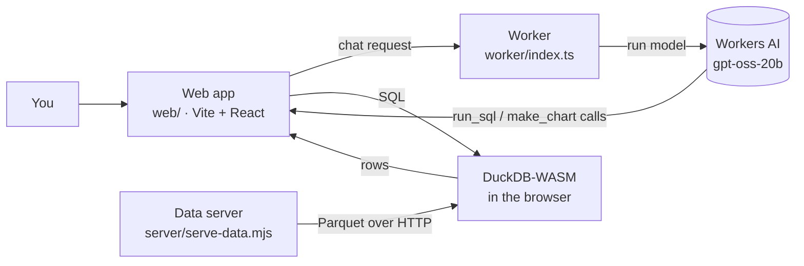

# F1 Chat

Ask plain-English questions about 2024 Formula 1 laps and results, and get answers with the numbers behind them.

A language model writes DuckDB SQL, the query runs **in your browser** with DuckDB-WASM, and the model answers from the rows it gets back. Long result lists are drawn as a table, and simple comparisons can be charted.

This is an R&D project, so things change often. For what is being worked on right now, see [docs/HANDOFF.md](docs/HANDOFF.md).

## How it works



1. The app loads 2024 `laps` and `results` Parquet files into DuckDB-WASM.
2. You ask a question. The model gets a single tool, `run_sql`, and writes a query.
3. DuckDB runs the query locally. Up to 200 rows go back to the model.
4. The model writes the answer. A `make_chart` tool can draw a bar or line chart.

Because the SQL runs in your browser, the model never sees more than the rows the query returns.

## Quick start

You need **Node 20+** and a Cloudflare account (the model runs on Workers AI).

```sh
npm install
npx wrangler login     # one time; the AI binding runs remotely
```

You also need the Parquet data. The data server reads from `DATA_ROOT` (default: a sibling checkout at `/Users/justin/github/off-the-pace/data`). The 2024 files must sit under `bronze/laps/season=2024/` and `bronze/results/season=2024/`.

Run three terminals:

| Terminal | Command | Port | What it does |
|---|---|---|---|
| 1 | `npm run data` | 8000 | Serves the Parquet files (read-only, CORS and HTTP Range) |
| 2 | `npm run worker` | 8787 | Worker that proxies chat requests to Workers AI |
| 3 | `npm run dev` | 5173 | Web app. Open <http://localhost:5173> |

Set `DATA_ROOT=/path/to/data` to point the data server somewhere else.

## Using the app

- **Ask** a question in the box. The answer appears with the SQL the model ran (in a collapsed section).
- **Explore schema** profiles the views and lets the model save notes about the data. Tick **Use exploration notes** to include those notes in later questions.

Example questions:

- Which driver had the fastest race lap of the season?
- How many race wins did each team get?
- Plot wins per team as a bar chart.

## Commands

| Command | Does |
|---|---|
| `npm run dev` | Start the web app with Vite |
| `npm run build` | Type-check, then build the web app into `web/dist` |
| `npm run typecheck` | Run `tsc --noEmit` |
| `npm run eval` | Run every question in `eval/questions.json` and write `eval/results-<timestamp>.json` |

For `npm run eval`, the data server and worker must be running. Set `ONLY=id1,id2` to run a subset of questions.

## Evaluation

- `eval/questions.json` holds the questions and their expected answers. Regenerate it from the raw Parquet with `python3 -m venv .venv && .venv/bin/pip install duckdb && .venv/bin/python eval/ground_truth.py`.
- `eval/run_eval.mjs` runs each question with notes off, explores the schema once, then runs again with notes on.
- `eval/score.mjs` scores answers. `eval/score.test.mjs` covers the scorer.

## Project layout

```
web/                 Browser app (Vite, React, DuckDB-WASM)
  src/chat.ts        Chat loop, the RULES prompt, and the table splitter
  src/dataGuide.ts   Schema text given to the model
  src/db.ts          DuckDB-WASM setup and file registration
  src/explore.ts     "Explore schema" and saved notes
  src/profile.ts     Column profiling for exploration
  src/chart.tsx      Recharts chart island
  src/main.ts        UI wiring
worker/index.ts      Cloudflare Worker: POST /chat -> Workers AI
server/serve-data.mjs  Local Parquet server with CORS and Range support
eval/                Questions, ground truth, scorer, runner
experiments/         Prompt and model trials, one folder per experiment
docs/                Handoff notes, decisions, known issues, logs
wrangler.toml        Worker config (model: @cf/openai/gpt-oss-20b)
```

## Configuration

| Setting | Where | Default |
|---|---|---|
| Model | `AI_MODEL` in `wrangler.toml` | `@cf/openai/gpt-oss-20b` |
| Data folder | `DATA_ROOT` env var | `/Users/justin/github/off-the-pace/data` |
| Data server port | `PORT` env var | `8000` |
| Model provider | `VITE_PROVIDER` (`local` or `cloudflare`) | `local` (Ollama) |
| Local model | `VITE_OLLAMA_URL`, `VITE_OLLAMA_MODEL` | `http://localhost:11434/v1`, `gpt-oss:20b-f1` |

To run the app on Cloudflare instead, use `VITE_PROVIDER=cloudflare npm run dev` and start the Worker. The local model needs `ollama create gpt-oss:20b-f1 -f eval/ollama/Modelfile` once (20k context, 8k output).

## Deploying

Don't deploy as-is. The worker allows any origin (`Access-Control-Allow-Origin: *`) and is meant for local development. Restrict CORS in `worker/index.ts` to your app's origin before running `wrangler deploy`.

## Documentation

- [docs/README.md](docs/README.md): index of the docs
- [docs/HANDOFF.md](docs/HANDOFF.md): current state, next steps, open decisions
- [docs/known-issues.md](docs/known-issues.md): data and model problems
- [docs/decisions/](docs/decisions/): why things are the way they are
- [experiments/README.md](experiments/README.md): prompt and model experiments
