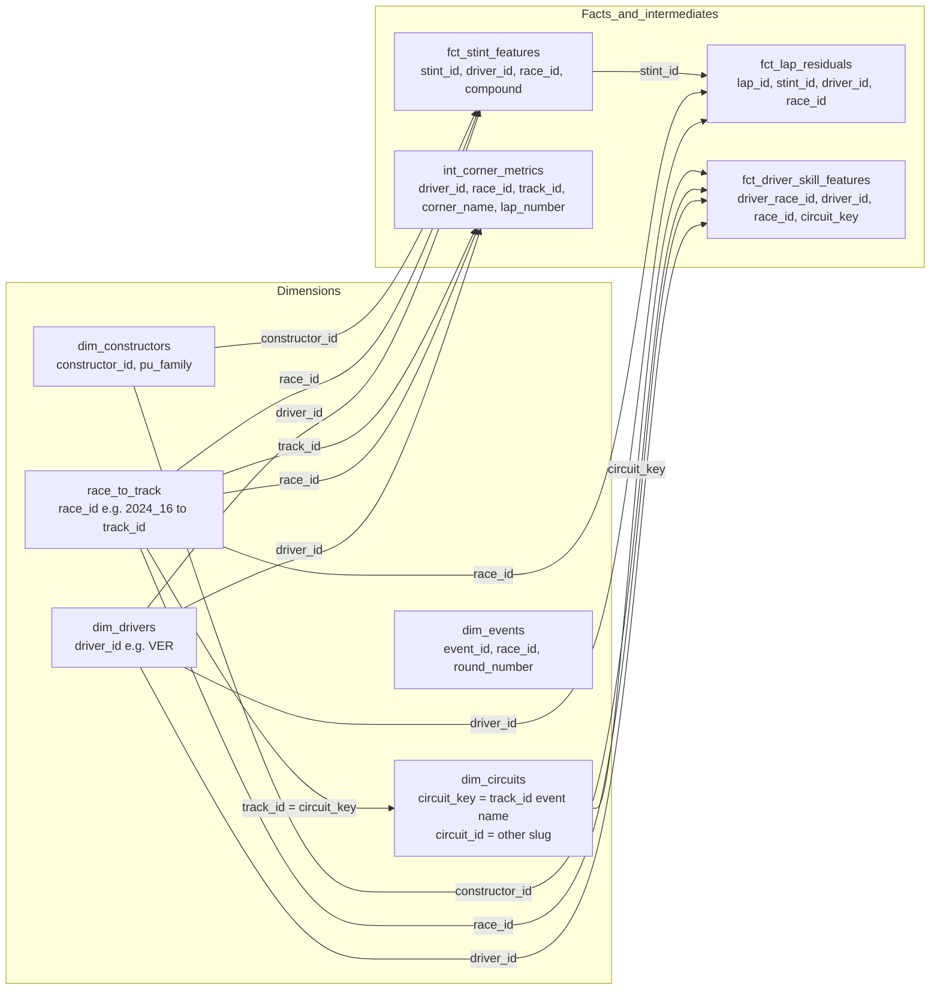
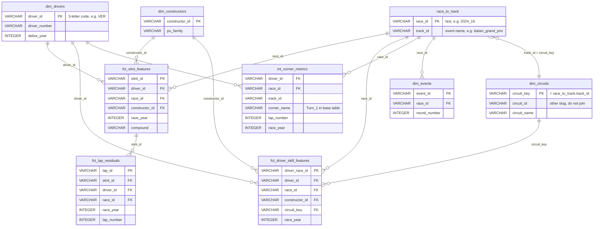

# Gold warehouse: how the tables join

Source: off-the-pace/app/public/data (39 tables, see _manifest.json). Joins below were checked against the Parquet files on 2026-10-19.

## Verified join keys

| Join | Match rows | Notes |
|---|---|---|
| fct_stint_features.race_id = race_to_track.race_id | 9,374 of 9,374 | race_id is text like `2024_16`; race_year is a separate integer column |
| fct_stint_features.driver_id = dim_drivers.driver_id | 9,374 of 9,374 | driver_id is the 3-letter code (VER, HAM) |
| race_to_track.track_id = dim_circuits.circuit_key | 173 | track_id is the event name, e.g. `italian_grand_prix` |
| dim_circuits.circuit_id = race_to_track.track_id | 0 | **Do not join on circuit_id.** It is a different slug, e.g. `silverstone_circuit` |
| fct_driver_skill_features.circuit_key = dim_circuits.circuit_key | 3,312 of 3,312 | |
| int_corner_metrics.race_id = race_to_track.race_id | matches | |
| int_corner_metrics.track_id = race_to_track.track_id | matches | |

## Naming traps seen in the trace

- Circuits: there is no `circuit_name` in `race_to_track`. The name Monza only appears in `dim_circuits.circuit_name` and the track_id `italian_grand_prix`. Filtering on the word Monza returns nothing.
- Corners: in the base tables the stored value is `Turn_1` (underscore). In the views (`v_corners`) it is `Turn 1`, because the view replaces underscores with spaces.
- Drivers: the number is in `dim_drivers.driver_number` (VER is `1`). Guessing a number returns nothing. In the views, `driver_id` values are listed in the schema (42 to 43 codes, e.g. `VER`, `ZHO`), so the model can use them directly.
- Seasons: `race_year` is an integer on every fact table; filter on it and on race_id together.

## Wide views (adapter only)

Created by `adapter.mjs` when `VIEWS=on`. They pre-join the base tables above. They are not in the manifest and are not in the data repo yet.

| View | Built from | Grain | Use it for |
|---|---|---|---|
| `v_corners` | int_corner_metrics + race_to_track | one row per driver, race, lap, corner | corner questions (braking, minimum speed, throttle point) |
| `v_stints` | fct_stint_features + race_to_track + dim_drivers | one row per stint | tyre and stint-length questions |
| `v_driver_season_skill` | fct_driver_skill_features + race_to_track | one row per driver per race | driver skill questions |

There is no lap-level view. `c1_lap_rows_2024` fails with views on for this reason (open question 10).

## Protocol for multi-table questions

1. **Resolve names to IDs first.** Look up the driver in dim_drivers, the race in race_to_track (by track_id, race_year), and the corner by its distinct `corner_name` values. Never filter on a name you have not seen in the data.
2. **Check stored values before filtering.** Run `SELECT DISTINCT <col> FROM <table> LIMIT 50` on any text column you plan to filter on. The `'SOFT'` case error is the same kind of mistake.
3. **Join only on the verified keys above.** Use race_id for a race, driver_id for a driver, track_id to circuit_key for a circuit. Do not guess a key.
4. **Always filter race_year and race_id together** so totals don't multiply across seasons.
5. **Aggregate in SQL**, then answer from the small result. Don't read long row lists.
6. **If a query returns zero rows, check the join and the filter values before concluding the data is missing.** A zero-row result from a bad key is not evidence that the data doesn't exist.

## ERD (key columns only)

Mermaid `erDiagram`. Only the verified keys above are drawn as relationships. Other columns are left out; see the manifest for the full schema. The three wide views are not drawn, because they are joined from these tables, not stored separately.

Keys checked for uniqueness on 2026-10-19 (rows equal distinct keys): dim_drivers, dim_constructors, race_to_track, dim_circuits, dim_events, fct_stint_features, fct_lap_residuals and fct_driver_skill_features all have a single-column key. `int_corner_metrics` has no single key column; the composite key `driver_id`, `race_id`, `lap_number`, `corner_name` is unique across 3,036,871 rows. It has no verified link to `fct_stint_features`, so a corner-to-stint join is not drawn.
