# Full data map: every table the app can query

Source: off-the-pace app/public/data (manifest, 39 tables) plus the three adapter views. Row counts and key checks were run on 2026-10-19 against the local export. The live bucket has a different manifest version; see "What the app can reach".

Written for: anyone who needs to see every table, its size, and which keys link them.

## What the app can reach

- **Through SQL (the model and the Query Lab):** the 39 tables in the manifest. The adapter adds three views when `VIEWS=on`.
- **In the bucket but not in the manifest:** 11 table folders, left over from no-delete publishing (`fct_racecraft`, `int_air_density`, `int_coast_tax_component`, `int_lap_energy_management`, `int_lap_line_deviation`, `int_lap_powertrain_signature`, `int_overtakes`, `int_penalties`, `int_race_control_events`, `int_track_geometry`, `int_wind_component`). The Query Lab only registers manifest names, so the model cannot query them. Their contents were not checked.
- **Staging copy:** `staging/`, 467 files. Pre-promotion revision; the app does not read it.
- **Models:** `models/`, 23 ONNX files plus encoders and a model card. Loaded separately, not tables.
- **Manifest archives:** two dated copies in `data/`.

## Tables and sizes

| Table | Storage | Rows | Columns | Reach |
|---|---|---|---|---|
| dim_circuits | single file | 44 | 11 | manifest |
| dim_compounds_season | single file | 499 | 16 | manifest |
| dim_drivers | single file | 43 | 4 | manifest |
| dim_constructors | single file | 19 | 2 | manifest |
| dim_events | single file | 6 | 10 | manifest |
| race_to_track | single file | 173 | 2 | manifest |
| fct_driver_skill_features | single file | 3,312 | 23 | manifest |
| fct_ghost_race_finish | single file | 30,344 | 26 | manifest |
| fct_stint_features | single file | 9,374 | 19 | manifest |
| mart_corner_skill_driver | partitioned | 161 | 17 | manifest |
| mart_degradation_history_envelope | single file | 8,075 | 19 | manifest |
| fct_lap_residuals | partitioned | 161,040 | 49 | manifest |
| fct_cliff_prediction_features | partitioned | 161,040 | 97 | manifest |
| fct_ghost_car_pace | partitioned | 1,442,208 | 38 | manifest |
| int_era_normalized_driver_rating | single file | 173 | 18 | manifest |
| int_constructor_structural_pace | single file | 1,644 | 12 | manifest |
| int_constructor_structural_pace_qualifying | single file | 1,730 | 10 | manifest |
| int_driver_circuit_affinity | single file | 1,024 | 16 | manifest |
| int_driver_circuit_era_affinity | single file | 1,419 | 16 | manifest |
| int_driver_race_skill_loro | single file | 3,275 | 13 | manifest |
| int_circuit_x_constructor_interaction | single file | 1,644 | 8 | manifest |
| int_qualifying_decomposed | single file | 16,876 | 36 | manifest |
| int_compound_cliff_predicted | single file | 161,040 | 18 | manifest |
| int_tyre_surface_vs_bulk_decoupling | single file | 38,819 | 14 | manifest |
| int_synthetic_teammate | single file | 140,460 | 14 | manifest |
| int_track_evolution | single file | 8,661 | 10 | manifest |
| int_field_pace_curve | single file | 9,119 | 11 | manifest |
| int_pit_strategy_value | single file | 8,281 | 24 | manifest |
| int_sc_hazard_history | single file | 173 | 15 | manifest |
| int_corner_metrics | partitioned | 3,036,871 | 9 | manifest |
| int_corner_skill_residuals | partitioned | 2,585,908 | 17 | manifest |
| int_lap_air_state | partitioned | 189,418 | 16 | manifest |
| int_lap_anomaly_flags | partitioned | 161,040 | 35 | manifest |
| int_sector_residual_decomposed | partitioned | 480,939 | 19 | manifest |
| race_caution_timeline | single file | 10,373 | 9 | manifest |
| int_dirty_air_tax_component | partitioned | 149,350 | 7 | manifest |
| fct_telemetry_deltas | partitioned | 28,628,356 | 10 | manifest |
| mart_degradation_predictions | partitioned | 160,207 | 19 | manifest |
| driver_network_rating | single file | 100 | 6 | manifest |
| v_corners | single file | 3,036,871 | 10 | view (adapter) |
| v_stints | single file | 9,374 | 8 | view (adapter) |
| v_driver_season_skill | single file | 3,312 | 10 | view (adapter) |

## Verified key links

An edge means the child table's key values all sit inside the parent's, checked in the join test. Drawn one-to-many from parent to child. Canonical parent per key:
- `driver_id` → `dim_drivers`
- `constructor_id` → `dim_constructors`
- `race_id` and `track_id` → `race_to_track`
- `circuit_key` and `circuit_id` → `dim_circuits` (see the note on circuit_id)
- `stint_id` → `fct_stint_features`
- `lap_id` → `fct_lap_residuals`
- `constructor_race_id` → `int_constructor_structural_pace`

86 edges:

| Child | Parent | Key |
|---|---|---|
| dim_compounds_season | dim_circuits | circuit_key |
| fct_cliff_prediction_features | dim_circuits | circuit_key |
| fct_driver_skill_features | dim_circuits | circuit_key |
| int_circuit_x_constructor_interaction | dim_circuits | circuit_key |
| int_driver_circuit_affinity | dim_circuits | circuit_id |
| int_driver_circuit_era_affinity | dim_circuits | circuit_id |
| int_driver_race_skill_loro | dim_circuits | circuit_key |
| mart_degradation_history_envelope | dim_circuits | circuit_id |
| mart_degradation_predictions | dim_circuits | circuit_key |
| fct_cliff_prediction_features | dim_constructors | constructor_id |
| fct_driver_skill_features | dim_constructors | constructor_id |
| fct_lap_residuals | dim_constructors | constructor_id |
| fct_stint_features | dim_constructors | constructor_id |
| int_circuit_x_constructor_interaction | dim_constructors | constructor_id |
| int_constructor_structural_pace | dim_constructors | constructor_id |
| int_constructor_structural_pace_qualifying | dim_constructors | constructor_id |
| int_corner_skill_residuals | dim_constructors | constructor_id |
| int_driver_race_skill_loro | dim_constructors | constructor_id |
| int_lap_anomaly_flags | dim_constructors | constructor_id |
| int_qualifying_decomposed | dim_constructors | constructor_id |
| int_sector_residual_decomposed | dim_constructors | constructor_id |
| int_synthetic_teammate | dim_constructors | constructor_id |
| driver_network_rating | dim_drivers | driver_id |
| fct_cliff_prediction_features | dim_drivers | driver_id |
| fct_driver_skill_features | dim_drivers | driver_id |
| fct_lap_residuals | dim_drivers | driver_id |
| fct_stint_features | dim_drivers | driver_id |
| int_compound_cliff_predicted | dim_drivers | driver_id |
| int_corner_metrics | dim_drivers | driver_id |
| int_corner_skill_residuals | dim_drivers | driver_id |
| int_driver_circuit_affinity | dim_drivers | driver_id |
| int_driver_circuit_era_affinity | dim_drivers | driver_id |
| int_driver_race_skill_loro | dim_drivers | driver_id |
| int_era_normalized_driver_rating | dim_drivers | driver_id |
| int_lap_air_state | dim_drivers | driver_id |
| int_lap_anomaly_flags | dim_drivers | driver_id |
| int_pit_strategy_value | dim_drivers | driver_id |
| int_qualifying_decomposed | dim_drivers | driver_id |
| int_sector_residual_decomposed | dim_drivers | driver_id |
| int_tyre_surface_vs_bulk_decoupling | dim_drivers | driver_id |
| mart_corner_skill_driver | dim_drivers | driver_id |
| fct_cliff_prediction_features | fct_lap_residuals | lap_id |
| int_compound_cliff_predicted | fct_lap_residuals | lap_id |
| int_corner_skill_residuals | fct_lap_residuals | lap_id |
| int_dirty_air_tax_component | fct_lap_residuals | lap_id |
| int_lap_anomaly_flags | fct_lap_residuals | lap_id |
| int_sector_residual_decomposed | fct_lap_residuals | lap_id |
| int_tyre_surface_vs_bulk_decoupling | fct_lap_residuals | lap_id |
| mart_degradation_predictions | fct_lap_residuals | lap_id |
| fct_cliff_prediction_features | fct_stint_features | stint_id |
| fct_lap_residuals | fct_stint_features | stint_id |
| int_compound_cliff_predicted | fct_stint_features | stint_id |
| int_corner_skill_residuals | fct_stint_features | stint_id |
| int_lap_air_state | fct_stint_features | stint_id |
| int_lap_anomaly_flags | fct_stint_features | stint_id |
| int_pit_strategy_value | fct_stint_features | stint_id |
| int_sector_residual_decomposed | fct_stint_features | stint_id |
| int_circuit_x_constructor_interaction | int_constructor_structural_pace | constructor_race_id |
| dim_events | race_to_track | race_id |
| fct_cliff_prediction_features | race_to_track | race_id |
| fct_driver_skill_features | race_to_track | race_id |
| fct_ghost_car_pace | race_to_track | race_id |
| fct_ghost_race_finish | race_to_track | race_id |
| fct_lap_residuals | race_to_track | race_id |
| fct_stint_features | race_to_track | race_id |
| fct_telemetry_deltas | race_to_track | race_id |
| fct_telemetry_deltas | race_to_track | track_id |
| int_circuit_x_constructor_interaction | race_to_track | race_id |
| int_compound_cliff_predicted | race_to_track | race_id |
| int_constructor_structural_pace | race_to_track | race_id |
| int_constructor_structural_pace_qualifying | race_to_track | race_id |
| int_corner_metrics | race_to_track | race_id |
| int_corner_metrics | race_to_track | track_id |
| int_corner_skill_residuals | race_to_track | race_id |
| int_corner_skill_residuals | race_to_track | track_id |
| int_driver_race_skill_loro | race_to_track | race_id |
| int_field_pace_curve | race_to_track | race_id |
| int_lap_air_state | race_to_track | race_id |
| int_lap_anomaly_flags | race_to_track | race_id |
| int_pit_strategy_value | race_to_track | race_id |
| int_qualifying_decomposed | race_to_track | race_id |
| int_sector_residual_decomposed | race_to_track | race_id |
| int_synthetic_teammate | race_to_track | race_id |
| int_track_evolution | race_to_track | race_id |
| int_tyre_surface_vs_bulk_decoupling | race_to_track | race_id |
| race_caution_timeline | race_to_track | race_id |

## ERD

```mermaid
erDiagram
    dim_circuits ||--o{ dim_compounds_season : "circuit_key"
    dim_circuits ||--o{ fct_cliff_prediction_features : "circuit_key"
    dim_circuits ||--o{ fct_driver_skill_features : "circuit_key"
    dim_circuits ||--o{ int_circuit_x_constructor_interaction : "circuit_key"
    dim_circuits ||--o{ int_driver_circuit_affinity : "circuit_id"
    dim_circuits ||--o{ int_driver_circuit_era_affinity : "circuit_id"
    dim_circuits ||--o{ int_driver_race_skill_loro : "circuit_key"
    dim_circuits ||--o{ mart_degradation_history_envelope : "circuit_id"
    dim_circuits ||--o{ mart_degradation_predictions : "circuit_key"
    dim_constructors ||--o{ fct_cliff_prediction_features : "constructor_id"
    dim_constructors ||--o{ fct_driver_skill_features : "constructor_id"
    dim_constructors ||--o{ fct_lap_residuals : "constructor_id"
    dim_constructors ||--o{ fct_stint_features : "constructor_id"
    dim_constructors ||--o{ int_circuit_x_constructor_interaction : "constructor_id"
    dim_constructors ||--o{ int_constructor_structural_pace : "constructor_id"
    dim_constructors ||--o{ int_constructor_structural_pace_qualifying : "constructor_id"
    dim_constructors ||--o{ int_corner_skill_residuals : "constructor_id"
    dim_constructors ||--o{ int_driver_race_skill_loro : "constructor_id"
    dim_constructors ||--o{ int_lap_anomaly_flags : "constructor_id"
    dim_constructors ||--o{ int_qualifying_decomposed : "constructor_id"
    dim_constructors ||--o{ int_sector_residual_decomposed : "constructor_id"
    dim_constructors ||--o{ int_synthetic_teammate : "constructor_id"
    dim_drivers ||--o{ driver_network_rating : "driver_id"
    dim_drivers ||--o{ fct_cliff_prediction_features : "driver_id"
    dim_drivers ||--o{ fct_driver_skill_features : "driver_id"
    dim_drivers ||--o{ fct_lap_residuals : "driver_id"
    dim_drivers ||--o{ fct_stint_features : "driver_id"
    dim_drivers ||--o{ int_compound_cliff_predicted : "driver_id"
    dim_drivers ||--o{ int_corner_metrics : "driver_id"
    dim_drivers ||--o{ int_corner_skill_residuals : "driver_id"
    dim_drivers ||--o{ int_driver_circuit_affinity : "driver_id"
    dim_drivers ||--o{ int_driver_circuit_era_affinity : "driver_id"
    dim_drivers ||--o{ int_driver_race_skill_loro : "driver_id"
    dim_drivers ||--o{ int_era_normalized_driver_rating : "driver_id"
    dim_drivers ||--o{ int_lap_air_state : "driver_id"
    dim_drivers ||--o{ int_lap_anomaly_flags : "driver_id"
    dim_drivers ||--o{ int_pit_strategy_value : "driver_id"
    dim_drivers ||--o{ int_qualifying_decomposed : "driver_id"
    dim_drivers ||--o{ int_sector_residual_decomposed : "driver_id"
    dim_drivers ||--o{ int_tyre_surface_vs_bulk_decoupling : "driver_id"
    dim_drivers ||--o{ mart_corner_skill_driver : "driver_id"
    fct_lap_residuals ||--o{ fct_cliff_prediction_features : "lap_id"
    fct_lap_residuals ||--o{ int_compound_cliff_predicted : "lap_id"
    fct_lap_residuals ||--o{ int_corner_skill_residuals : "lap_id"
    fct_lap_residuals ||--o{ int_dirty_air_tax_component : "lap_id"
    fct_lap_residuals ||--o{ int_lap_anomaly_flags : "lap_id"
    fct_lap_residuals ||--o{ int_sector_residual_decomposed : "lap_id"
    fct_lap_residuals ||--o{ int_tyre_surface_vs_bulk_decoupling : "lap_id"
    fct_lap_residuals ||--o{ mart_degradation_predictions : "lap_id"
    fct_stint_features ||--o{ fct_cliff_prediction_features : "stint_id"
    fct_stint_features ||--o{ fct_lap_residuals : "stint_id"
    fct_stint_features ||--o{ int_compound_cliff_predicted : "stint_id"
    fct_stint_features ||--o{ int_corner_skill_residuals : "stint_id"
    fct_stint_features ||--o{ int_lap_air_state : "stint_id"
    fct_stint_features ||--o{ int_lap_anomaly_flags : "stint_id"
    fct_stint_features ||--o{ int_pit_strategy_value : "stint_id"
    fct_stint_features ||--o{ int_sector_residual_decomposed : "stint_id"
    int_constructor_structural_pace ||--o{ int_circuit_x_constructor_interaction : "constructor_race_id"
    race_to_track ||--o{ dim_events : "race_id"
    race_to_track ||--o{ fct_cliff_prediction_features : "race_id"
    race_to_track ||--o{ fct_driver_skill_features : "race_id"
    race_to_track ||--o{ fct_ghost_car_pace : "race_id"
    race_to_track ||--o{ fct_ghost_race_finish : "race_id"
    race_to_track ||--o{ fct_lap_residuals : "race_id"
    race_to_track ||--o{ fct_stint_features : "race_id"
    race_to_track ||--o{ fct_telemetry_deltas : "race_id"
    race_to_track ||--o{ fct_telemetry_deltas : "track_id"
    race_to_track ||--o{ int_circuit_x_constructor_interaction : "race_id"
    race_to_track ||--o{ int_compound_cliff_predicted : "race_id"
    race_to_track ||--o{ int_constructor_structural_pace : "race_id"
    race_to_track ||--o{ int_constructor_structural_pace_qualifying : "race_id"
    race_to_track ||--o{ int_corner_metrics : "race_id"
    race_to_track ||--o{ int_corner_metrics : "track_id"
    race_to_track ||--o{ int_corner_skill_residuals : "race_id"
    race_to_track ||--o{ int_corner_skill_residuals : "track_id"
    race_to_track ||--o{ int_driver_race_skill_loro : "race_id"
    race_to_track ||--o{ int_field_pace_curve : "race_id"
    race_to_track ||--o{ int_lap_air_state : "race_id"
    race_to_track ||--o{ int_lap_anomaly_flags : "race_id"
    race_to_track ||--o{ int_pit_strategy_value : "race_id"
    race_to_track ||--o{ int_qualifying_decomposed : "race_id"
    race_to_track ||--o{ int_sector_residual_decomposed : "race_id"
    race_to_track ||--o{ int_synthetic_teammate : "race_id"
    race_to_track ||--o{ int_track_evolution : "race_id"
    race_to_track ||--o{ int_tyre_surface_vs_bulk_decoupling : "race_id"
    race_to_track ||--o{ race_caution_timeline : "race_id"

    dim_circuits {
        VARCHAR circuit_key PK
        VARCHAR circuit_id
    }
    dim_compounds_season {
        VARCHAR circuit_key
    }
    dim_drivers {
        VARCHAR driver_id PK
    }
    dim_constructors {
        VARCHAR constructor_id PK
    }
    dim_events {
        VARCHAR race_id
    }
    race_to_track {
        VARCHAR race_id PK
        VARCHAR track_id
    }
    fct_driver_skill_features {
        VARCHAR circuit_key
        VARCHAR constructor_id
        VARCHAR driver_id
        VARCHAR race_id
    }
    fct_ghost_race_finish {
        VARCHAR race_id
    }
    fct_stint_features {
        VARCHAR constructor_id
        VARCHAR driver_id
        VARCHAR stint_id PK
        VARCHAR race_id
    }
    mart_corner_skill_driver {
        VARCHAR driver_id
    }
    mart_degradation_history_envelope {
        VARCHAR circuit_id
    }
    fct_lap_residuals {
        VARCHAR constructor_id
        VARCHAR driver_id
        VARCHAR lap_id PK
        VARCHAR stint_id
        VARCHAR race_id
    }
    fct_cliff_prediction_features {
        VARCHAR circuit_key
        VARCHAR constructor_id
        VARCHAR driver_id
        VARCHAR lap_id
        VARCHAR stint_id
        VARCHAR race_id
    }
    fct_ghost_car_pace {
        VARCHAR race_id
    }
    int_era_normalized_driver_rating {
        VARCHAR driver_id
    }
    int_constructor_structural_pace {
        VARCHAR constructor_id
        VARCHAR constructor_race_id PK
        VARCHAR race_id
    }
    int_constructor_structural_pace_qualifying {
        VARCHAR constructor_id
        VARCHAR race_id
    }
    int_driver_circuit_affinity {
        VARCHAR circuit_id
        VARCHAR driver_id
    }
    int_driver_circuit_era_affinity {
        VARCHAR circuit_id
        VARCHAR driver_id
    }
    int_driver_race_skill_loro {
        VARCHAR circuit_key
        VARCHAR constructor_id
        VARCHAR driver_id
        VARCHAR race_id
    }
    int_circuit_x_constructor_interaction {
        VARCHAR circuit_key
        VARCHAR constructor_id
        VARCHAR constructor_race_id
        VARCHAR race_id
    }
    int_qualifying_decomposed {
        VARCHAR constructor_id
        VARCHAR driver_id
        VARCHAR race_id
    }
    int_compound_cliff_predicted {
        VARCHAR driver_id
        VARCHAR lap_id
        VARCHAR stint_id
        VARCHAR race_id
    }
    int_tyre_surface_vs_bulk_decoupling {
        VARCHAR driver_id
        VARCHAR lap_id
        VARCHAR race_id
    }
    int_synthetic_teammate {
        VARCHAR constructor_id
        VARCHAR race_id
    }
    int_track_evolution {
        VARCHAR race_id
    }
    int_field_pace_curve {
        VARCHAR race_id
    }
    int_pit_strategy_value {
        VARCHAR driver_id
        VARCHAR stint_id
        VARCHAR race_id
    }
    int_corner_metrics {
        VARCHAR driver_id
        VARCHAR race_id
        VARCHAR track_id
    }
    int_corner_skill_residuals {
        VARCHAR constructor_id
        VARCHAR driver_id
        VARCHAR lap_id
        VARCHAR stint_id
        VARCHAR race_id
        VARCHAR track_id
    }
    int_lap_air_state {
        VARCHAR driver_id
        VARCHAR stint_id
        VARCHAR race_id
    }
    int_lap_anomaly_flags {
        VARCHAR constructor_id
        VARCHAR driver_id
        VARCHAR lap_id
        VARCHAR stint_id
        VARCHAR race_id
    }
    int_sector_residual_decomposed {
        VARCHAR constructor_id
        VARCHAR driver_id
        VARCHAR lap_id
        VARCHAR stint_id
        VARCHAR race_id
    }
    race_caution_timeline {
        VARCHAR race_id
    }
    int_dirty_air_tax_component {
        VARCHAR lap_id
    }
    fct_telemetry_deltas {
        VARCHAR race_id
        VARCHAR track_id
    }
    mart_degradation_predictions {
        VARCHAR circuit_key
        VARCHAR lap_id
    }
    driver_network_rating {
        VARCHAR driver_id
    }
```

## Notes and gaps

- **Partial matches are not drawn.** `mart_corner_skill_driver` covers 18 of 19 constructors and 40 of 43 drivers. `mart_degradation_predictions` matches 8,224 of its 8,247 stints. They are subsets, so the links hold, but they are left out to keep the diagram readable.
- **Views are not drawn.** `v_corners`, `v_stints` and `v_driver_season_skill` are joins of base tables (see DATA_MAP.md). They have no keys of their own.
- **No links found for:** `int_sc_hazard_history`. Its keys are `circuit_slug` and `season`, and neither matches another table in the test.
- **Qualifying laps do not join to race laps.** `int_qualifying_decomposed` has 16,876 `lap_id` values, and none match a race-lap table. Treat it as its own spine.
- **`ego_driver_id` and `host_constructor_id`** join among the three ghost tables (`fct_ghost_race_finish`, `fct_ghost_car_pace`, `int_synthetic_teammate`). Their match to `dim_drivers` and `dim_constructors` was not tested, because the column names differ.
- **`circuit_id` is a different slug from `track_id`.** It joins among `dim_circuits`, `mart_degradation_history_envelope`, `int_driver_circuit_affinity` and `int_driver_circuit_era_affinity`, but matches nothing in `race_to_track`. Same warning as DATA_MAP.md.
- **Unique keys (checked):** `dim_drivers.driver_id`, `dim_constructors.constructor_id`, `race_to_track.race_id`, `dim_circuits.circuit_key`, `dim_events.event_id`, `fct_stint_features.stint_id`, `fct_lap_residuals.lap_id`, `fct_driver_skill_features.driver_race_id`, `int_constructor_structural_pace.constructor_race_id`, `int_constructor_structural_pace_qualifying.constructor_race_id`. Key uniqueness on other tables was not checked.
- **Largest tables:** `fct_telemetry_deltas` (28.6 M rows) and `int_corner_metrics` (3.0 M). Queries that scan these are the slow ones. Filter on `race_id` or `race_year` first.
